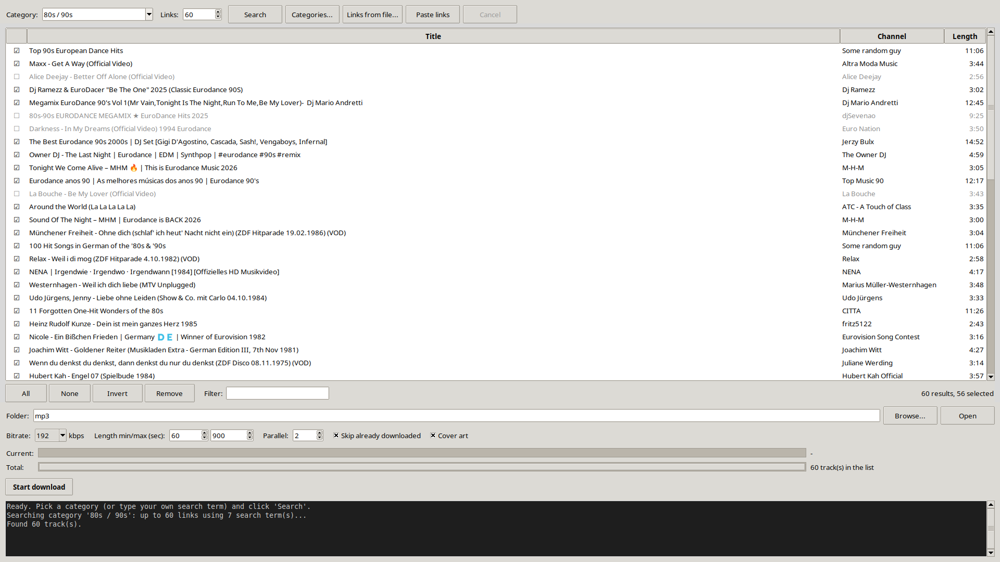

# YouTube to MP3 Downloader

Pick a category → 100–500 matching YouTube links are found automatically →
choose the ones you want → download them as MP3.



| | |
|---|---|
| **Search** | Several search terms per category; duplicates and live streams are filtered out |
| **Choose** | All results in one table with check boxes, filter and sorting |
| **Download** | `yt-dlp` + FFmpeg, MP3 with title, artist and cover art, two progress bars; failed videos are skipped instead of stopping the run |

---

## Installation

You only need **Python 3.10 or newer**. Everything else (yt-dlp, FFmpeg and
Deno) is installed automatically on the first start.

**Windows**
1. Install Python from [python.org/downloads](https://www.python.org/downloads/)
   using the default options.
2. Double-click **`start-windows.bat`**.

**macOS**
1. Install Python from [python.org/downloads](https://www.python.org/downloads/macos/).
2. Double-click **`start-macos.command`**. If macOS refuses to open it the
   first time, right-click it → *Open*.

**Linux**
1. Python is usually already installed. On Debian/Ubuntu you may also need
   `sudo apt install python3-tk python3-venv`.
2. Run `./start.sh` in a terminal.

The first start takes about a minute: it creates a private `.venv` folder
inside the project and installs the components there. **Nothing is installed
system-wide**, so deleting the project folder removes everything. Later starts
open the app right away, and yt-dlp is updated once a week because YouTube
changes often break older versions.

> Developers can also run `python run_gui.py`, which does exactly the same as
> the start scripts. `python run_gui.py --update` updates all components
> right away.

---

## How to use it

**1 · Search**
Pick a category from the drop-down (or type any search term into it), set
the number of links you want and click *Search*. The app goes through the
category's search terms until it has enough links.

**2 · Choose**
Untick what you don't need:

| Action | How |
|---|---|
| Tick/untick one track | Click the check box |
| Tick/untick highlighted rows | `Space` or `Enter` |
| All / None / Invert | Buttons below the table (or click the check box column header) |
| Search the list | *Filter* field – *All/None* then only affect the filtered rows |
| Sort | Click a column header |
| Remove rows from the list | Highlight them, then *Remove* or `Delete` |
| Listen to a track first | Double-click it – it opens in the web browser |

**3 · Download**
Click *Start download*. The top bar shows the current file, the bottom bar
the overall progress. *Cancel* stops right away and removes half-finished
files.

> **Links from file…** reads a text file with one YouTube link per line and
> adds the tracks to the list. **Paste links** does the same with links you
> copied to the clipboard.

---

## Settings

Saved automatically in `config/settings.json`.

| Setting | Default | Meaning |
|---|---|---|
| Folder | `mp3/` | Where the MP3 files are saved |
| Bitrate | 192 | 128 / 192 / 256 / 320 kbps |
| Length min/max | 60 / 900 sec | Removes shorts and hour-long mixes from search results (0 = off) |
| Parallel | 2 | Simultaneous downloads (1–8) – more than 3 makes YouTube slow you down |
| Skip already downloaded | on | Keeps `downloaded_archive.txt` in the output folder, so nothing is downloaded twice |
| Cover art | on | Embeds the video thumbnail as album cover |

---

## Your own categories

Click **Categories…** to create, rename or delete categories and edit their
search terms (one per line). Everything is stored in `config/categories.json`,
which you can also edit directly:

```json
{
  "Techno": ["techno {year}", "hard techno set", "melodic techno"],
  "Arabesque": ["arabesk şarkılar", "müslüm gürses", "damar arabesk"]
}
```

`{year}` and `{last_year}` are replaced with the current and the previous
year, so search terms like "charts {year}" never go stale.

**Rule of thumb:** 10–15 search terms per category for 500 links. The app
asks for more results per search term when many of them are filtered out,
and stops as soon as it has enough.

14 categories are included: Pop · Party · Disco · Techno · House · Turkish ·
Arabesque · Arabic · Balkan · Rap/HipHop · 80s/90s · Charts · Schlager · Rock.

---

## Troubleshooting

| Problem | Cause and fix |
|---|---|
| The start script says Python was not found | Install Python 3.10+ (see *Installation*) and start again |
| "tkinter is missing" | Linux: `sudo apt install python3-tk` (Debian/Ubuntu) |
| Linux: `[x]` instead of check boxes, `?` in some titles | Your Python (e.g. installed with uv, mise or pyenv) has a Tk without modern font support. Downloads work normally. For nicer text, start with the system Python (`/usr/bin/python3 run_gui.py`) after deleting the `.venv` folder |
| Many failed downloads, HTTP 429 | Lower *Parallel* to 1–2 |
| Many failed downloads after a while of working fine | YouTube changed something: run `python run_gui.py --update` |
| Only hour-long mixes in the list | Lower the maximum length, e.g. to 600 sec |
| Fewer results than requested | Add more search terms to the category, or relax the length filter |
| A track is missing from the MP3s | See `logs/failed.log` – it lists the video id and the reason |
| Nothing is downloaded although tracks are ticked | *Skip already downloaded* is on and the videos are already in the archive |
| The app crashed or behaves strangely | See `logs/error.log` |
| Something is completely broken | Delete the `.venv` folder and start again – the setup runs once more |

---

## Project structure

```
start-windows.bat          double-click start (Windows)
start-macos.command        double-click start (macOS)
start.sh                   start (Linux, also macOS)
run_gui.py                 first-start setup + launch of the app
youtube_to_mp3.py          downloads every link of urls.txt, no GUI
requirements.txt           yt-dlp, imageio-ffmpeg (FFmpeg), deno
config/
  categories.json          categories and their search terms
  settings.json            saved settings
logs/
  failed.log               skipped videos and the reason
  error.log                unexpected errors
ytmp3/
  models.py                data containers (Track, AppSettings, ProgressEvent)
  config.py                loading and saving the JSON files
  tools.py                 finds FFmpeg and the JavaScript runtime
  search.py                search via ytsearchN:, dedupe, length filter
  downloader.py            download + MP3 conversion, progress, errors
  gui/
    app.py                 main window, thread handling
    results_view.py        result table with check box column
    category_editor.py     category editor
```

Search and download also work without the GUI (run them with the Python in
`.venv`, e.g. `.venv/bin/python` or `.venv\Scripts\python.exe`):

```sh
python -m ytmp3.search Techno 50      # category or any search term
python -m ytmp3.downloader urls.txt   # download a file of links
```

**Important for development:** search and download run in background
threads and report back through a `queue.Queue` that the GUI empties every
100 ms. Tkinter widgets must only be touched from the main thread –
otherwise you get random crashes.

---

## Notes

The app needs an internet connection.

Only download content you have the right to download, and respect copyright
law and the terms of service of the website.
